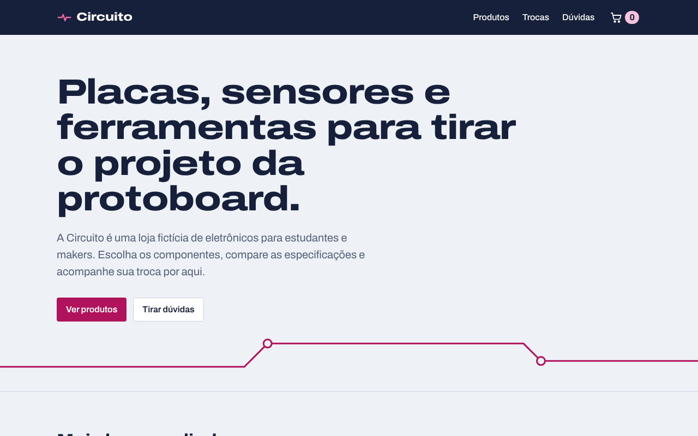
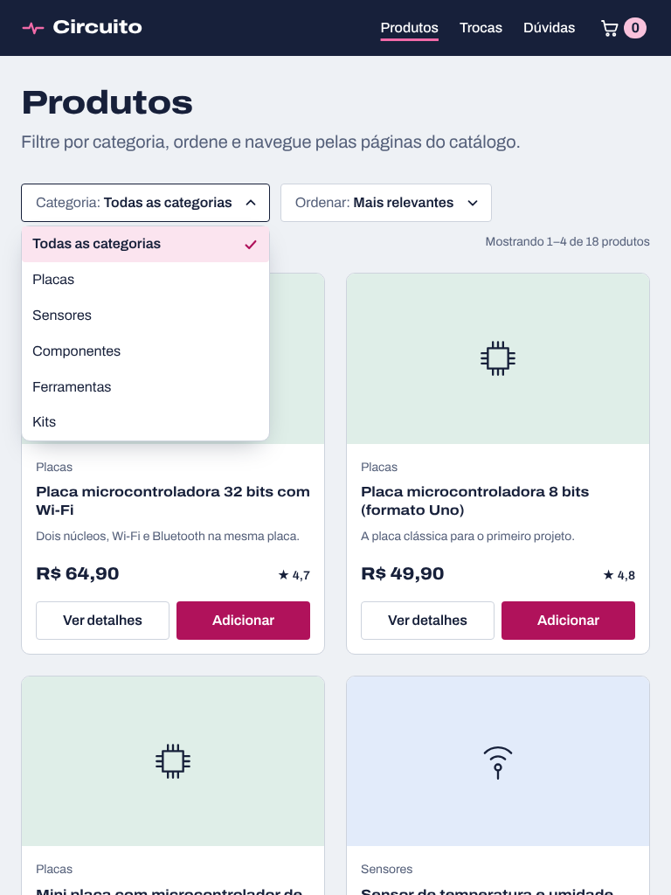
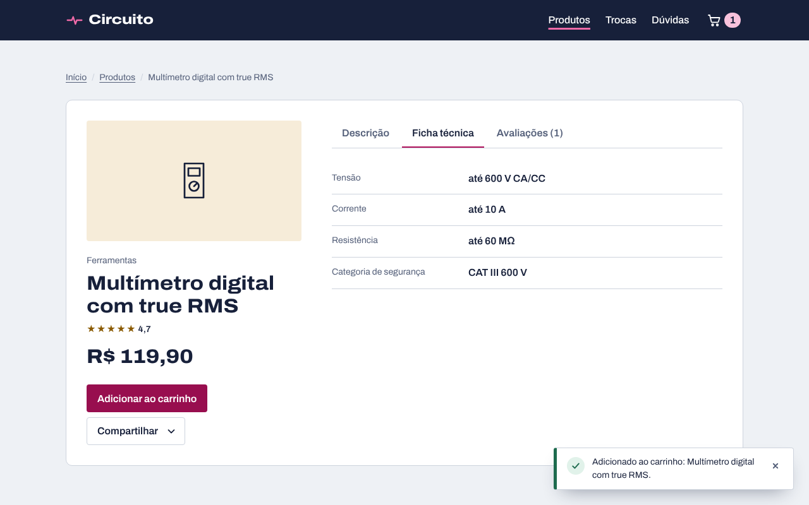
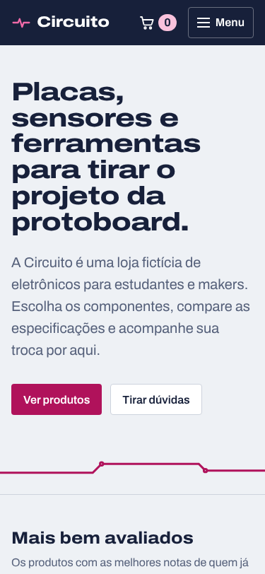
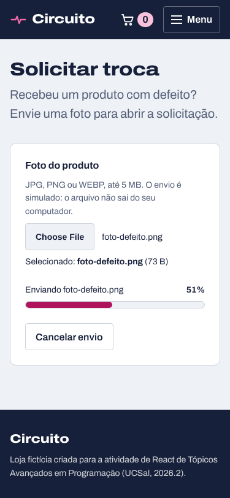
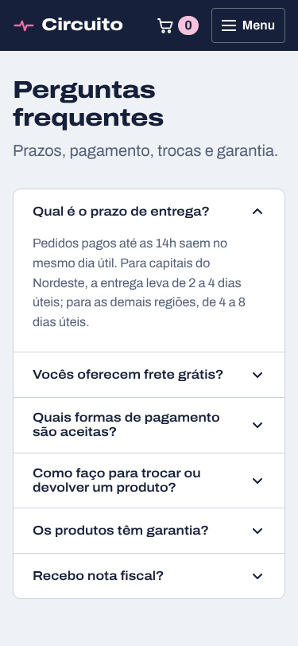
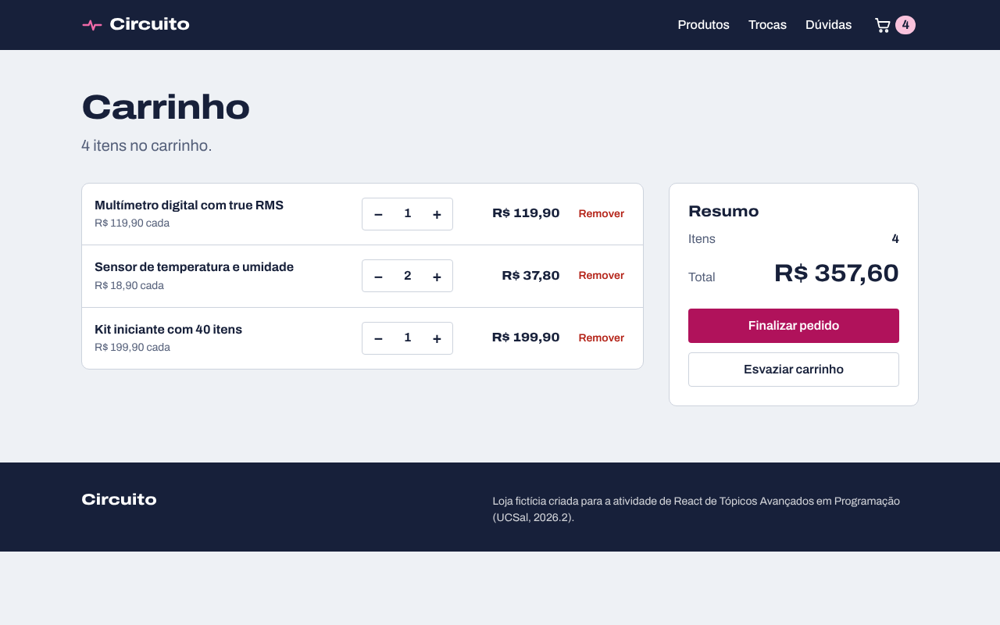

# Circuito: loja fictícia em React

Atividade de React da disciplina Tópicos Avançados em Programação (UCSal, Engenharia de Software, 2026.2).

Aplicação web responsiva de uma loja fictícia de eletrônicos para estudantes e makers. Os seis componentes pedidos (acordeão, paginação, barra de progresso, abas, menu suspenso e notificação toast) foram feitos do zero em React, sem biblioteca de UI, e aparecem em situações reais da loja: catálogo, página de produto, solicitação de troca e perguntas frequentes.

**Vídeo explicativo:** _(link a adicionar)_



## Sumário

- [Como rodar](#como-rodar)
- [Versões no repositório](#versões-no-repositório)
- [Os 6 componentes](#os-6-componentes)
- [Conceitos de React usados](#conceitos-de-react-usados)
- [Desafio extra: Context API e React Router](#desafio-extra-context-api-e-react-router)
- [Responsividade](#responsividade)
- [Acessibilidade](#acessibilidade)
- [Estrutura de pastas](#estrutura-de-pastas)

## Como rodar

### No GitHub Codespaces (ambiente da disciplina)

1. No repositório, clique em **Code → Codespaces → Create codespace on main**.
2. Espere o ambiente abrir. O arquivo `.devcontainer/devcontainer.json` prepara tudo sozinho: Node.js, `npm install`, a porta do Vite e o pacote de idioma do VS Code em português.
3. No terminal, rode `npm run dev`.
4. Quando aparecer o aviso da porta **5173**, clique em **Open in Browser**.

### No computador

Requer Node.js 22.22 ou mais recente (exigência do React Router 8).

```bash
npm install
npm run dev
```

| Comando | O que faz |
|---|---|
| `npm run dev` | Servidor de desenvolvimento com recarga automática |
| `npm run build` | Gera a versão de produção na pasta `dist` |
| `npm run preview` | Abre a versão de produção localmente |
| `npm run lint` | Verifica o código com o oxlint, incluindo regras de acessibilidade (jsx-a11y) |

## Versões no repositório

| Branch | O que tem |
|---|---|
| `main` | Versão final, com o desafio extra: páginas com **React Router** e estado global com **Context API** |
| `v1-base` | Versão base: página única com os 6 componentes. O `App` guarda o estado e passa tudo por props |

O histórico de commits do `main` mostra a passagem de uma versão para a outra, um passo por commit.

## Os 6 componentes

Todos ficam em `src/components`, cada um com seu `.jsx` e seu `.module.css`, e recebem os dados por props.

| Componente | Arquivo | Onde aparece | O que o PDF pede e como foi feito |
|---|---|---|---|
| **Acordeão** | `Accordion/Accordion.jsx` | Perguntas frequentes (`/duvidas`) | Itens recebidos por props (`items`). O state `openItemId` deixa um item aberto por vez. A abertura e o fechamento têm transição suave (`grid-template-rows`). Usa `aria-expanded` e `aria-controls` |
| **Paginação** | `Pagination/Pagination.jsx` | Catálogo (`/produtos`) | Recebe `currentPage`, `totalPages` e o callback `onPageChange`. Tem botões anterior e próxima, desabilitados nas pontas, e botões de página com reticências (1 … 4 5 6 … 12). A página atual tem `aria-current="page"` |
| **Barra de Progresso** | `ProgressBar/ProgressBar.jsx` | Solicitar troca (`/trocas`) | Recebe `value` (0–100) e ajusta a largura do preenchimento. Mostra o percentual e usa `role="progressbar"` com `aria-valuenow`. O envio é simulado com `useEffect` + `setInterval` |
| **Abas** | `Tabs/Tabs.jsx` | Página do produto (`/produtos/:id`) | Recebe `tabs` (rótulo e conteúdo) por props e guarda a aba ativa no state `activeTabId`. Dá para trocar de aba com as setas ← →, Home e End. Usa `role="tablist"`, `tab` e `tabpanel` |
| **Menu Suspenso** | `Dropdown/Dropdown.jsx` | Filtro e ordenação no catálogo; "Compartilhar" no produto | A visibilidade fica no state `isOpen` e as opções chegam por props, cada uma com seu callback `onSelect`. Fecha ao escolher, ao clicar fora (hook `useClickOutside`) e com Esc |
| **Toast** | `Toast/Toast.jsx` e `Toast/ToastContainer.jsx` | Carrinho, compartilhar, envio da foto, erros | Recebe `type` (sucesso, erro, aviso, info) e `message`. Some sozinho em 5 s (`useEffect` + `setTimeout`) ou pelo botão fechar, e pausa com o mouse em cima. Vários toasts empilhados via Context |

| Catálogo no tablet, com o menu suspenso aberto | Produto no desktop: abas e toast |
|---|---|
|  |  |

## Conceitos de React usados

| Conceito | Onde ver no código |
|---|---|
| Componente principal que orquestra os demais | `src/App.jsx`: define as rotas. `src/main.jsx`: monta os providers |
| Componentes funcionais | Todos em `src/components`, `src/features` e `src/pages` |
| Componente de classe | `src/components/ErrorBoundary/ErrorBoundary.jsx`: `getDerivedStateFromError` e `componentDidCatch` só existem em classes |
| Props | Todos os 6 componentes. Exemplo: `<Pagination currentPage totalPages onPageChange />` |
| State local (`useState`) | `Accordion` (item aberto), `Tabs` (aba ativa), `Dropdown` (aberto/fechado), `Toast` (pausado), `ExchangeRequest` (arquivo, progresso, status), `Header` (menu do celular) |
| `useEffect` com limpeza | `Toast` (timer), `ExchangeRequest` (intervalo do envio), `useClickOutside` (listener), `CartProvider` (salva no `localStorage`), `MainLayout` (foco ao trocar de página) |
| `useRef` | Foco das abas e do menu suspenso (`Tabs`, `Dropdown`), campo de arquivo (`ExchangeRequest`), contador de ids dos toasts (`ToastProvider`) |
| `useMemo` e `useCallback` | Filtro e ordenação do catálogo (`ProductCatalog`). Funções e valor estáveis nos providers (`ToastProvider`, `CartProvider`) |
| `useId` | Ids únicos para ligar rótulos e ARIA (`Accordion`, `Tabs`, `Dropdown`, `ProgressBar`) |
| Hooks personalizados | `useToast`, `useCart`, `useClickOutside` em `src/hooks` |
| Manipulação de eventos | `onClick`, `onKeyDown` (setas, Home, End, Esc), `onChange` (arquivo), `onMouseEnter`/`onFocus` (pausa do toast) |
| Renderização condicional e listas com `key` | Lista do menu suspenso só existe aberta; cartões, abas e itens do carrinho com `key` |

## Desafio extra: Context API e React Router

Os dois recursos foram implementados.

**Context API (estado global).** Dois contextos ficam em `src/context`:

- **ToastContext**: qualquer componente mostra uma notificação com `const { showToast } = useToast()`, sem receber a função por props. Antes, na versão `v1-base`, ela passava por props pelo `App`.
- **CartContext**: compartilha o carrinho entre componentes sem relação direta. O contador do cabeçalho, os botões "Adicionar" dos cartões e a página `/carrinho` leem e alteram o mesmo estado. O carrinho fica salvo no `localStorage`.

**React Router (páginas).** As rotas ficam em `src/App.jsx` e as páginas em `src/pages`:

| Rota | Página |
|---|---|
| `/` | Início, com os produtos mais bem avaliados |
| `/produtos` | Catálogo. Filtro, ordenação e página ficam na URL (`?categoria=sensors&pagina=2`) com `useSearchParams` |
| `/produtos/:productId` | Produto, que lê o id da URL com `useParams` |
| `/trocas` | Solicitar troca |
| `/duvidas` | Perguntas frequentes |
| `/carrinho` | Carrinho |
| `*` | Página 404 |

O `MainLayout` usa `<Outlet />` para manter cabeçalho e rodapé entre as páginas. O menu usa `NavLink`, que marca a página atual.

## Responsividade

O layout é mobile-first: o CSS base é o do celular e as media queries ampliam em **600px** (tablet) e **1024px** (desktop). Grid e Flexbox reorganizam os elementos:

- O catálogo tem 1, 2 ou 4 colunas, conforme a largura.
- O menu vira um botão "Menu" no celular.
- A página de produto põe as abas embaixo no celular e ao lado no desktop.
- Os toasts ocupam a largura toda no celular e ficam no canto no desktop.
- Os cartões usam container query para empilhar os botões quando ficam estreitos.

Testado em 375px, 768px e 1280px, sem rolagem horizontal.

| Celular: início | Celular: troca com barra de progresso | Celular: dúvidas |
|---|---|---|
|  |  |  |



## Acessibilidade

- **Semântica e estrutura da página:**
  - HTML5 semântico: `header`, `nav`, `main`, `section`, `article`, `aside`, `footer`, `dl`, `fieldset`.
  - Um `h1` por página e níveis de título em ordem.
- **Teclado:**
  - Os componentes seguem os padrões de teclado e ARIA da WAI-ARIA: abas, menu e acordeão.
  - Tudo funciona pelo teclado, e o foco fica visível (`:focus-visible`).
  - Há um link "Pular para o conteúdo" no início da página.
- **Navegação entre páginas:** ao trocar de página, a tela volta ao topo e o foco vai para o título da nova página. Cada página tem seu próprio `<title>`.
- **Toasts:**
  - São anunciados por `aria-live` (erros com `role="alert"`).
  - O tipo é indicado por ícone e texto, não só pela cor.
  - Pausam com o mouse ou o foco.
- **Movimento:** `prefers-reduced-motion` desliga as animações para quem pediu isso ao sistema.
- **Verificação:**
  - Lighthouse: **100 em Acessibilidade**, 100 em Boas práticas e 100 em SEO nas seis páginas principais, no celular e no desktop.
  - axe-core: nenhum problema nas páginas nem nos estados abertos (menus, toasts, abas, menu do celular).

## Estrutura de pastas

```
src/
├── main.jsx              # ponto de entrada: BrowserRouter + providers
├── App.jsx               # componente principal: tabela de rotas
├── index.css             # variáveis de design, reset, foco, utilitários
├── components/           # os 6 componentes reutilizáveis + ErrorBoundary
│   └── layout/           # Header, Footer, Page, Section, Breadcrumb
├── context/              # ToastContext/Provider e CartContext/Provider
├── hooks/                # useToast, useCart, useClickOutside
├── layouts/              # MainLayout (Outlet)
├── pages/                # uma página por rota
├── features/             # partes da loja: catálogo, detalhes, troca
├── data/                 # produtos e perguntas fictícios
└── utils/                # formatação de moeda e tamanho de arquivo
```

## Tecnologias

- React 19, React Router 8 e Vite 8
- CSS puro com CSS Modules (sem biblioteca de UI)
- oxlint com regras de acessibilidade
- Nomes no código em inglês e comentários em português
